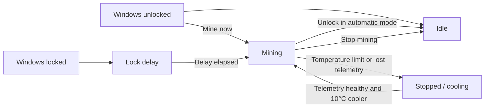

<p align="center">
  
</p>

<h1 align="center">PearlPilot</h1>

<p align="center">
  A focused Windows 11 tray controller for safe, unattended Pearl mining with WildRig.
</p>

<p align="center">
  <a href="https://github.com/joelfourhman/PearlPilot/actions/workflows/ci.yml"></a>
  
  
</p>

> Lock → wait → mine. Unlock → stop. Or choose **Mine now** from the tray.

PearlPilot runs as the signed-in user, supervises exactly one WildRig process, and stays out of the way until it has something useful to report. Automatic mode mines only after Windows has remained locked for the configured delay. Manual mode bypasses the lock requirement, but never bypasses temperature, telemetry, ownership, duplicate-process, or crash-loop protections.

> **Bring your own miner:** PearlPilot does not download, bundle, install, or update WildRig. Obtain and verify WildRig separately, then select its executable during setup.

## Why PearlPilot

- **Tiny surface area:** one tray process, one PowerShell module, one JSON settings file.
- **Fail-safe defaults:** unknown lock state or missing NVIDIA telemetry prevents automatic mining.
- **Immediate control:** right-click **Mine now** / **Stop mining** without opening a terminal.
- **Thermal hysteresis:** stop at the configured limit; resume only after cooling another 10°C.
- **Exact ownership:** PID plus creation time prevents stopping an unrelated process.
- **No elevation or service:** a limited per-user scheduled task starts the app invisibly after sign-in.
- **No secrets:** PearlPilot needs only a public `prl1...` payout address—never a seed phrase or private key.

## How it works



PearlPilot launches WildRig with `pearlhash` against `pool.pearlhash.xyz:9000`. Pool selection is intentionally fixed: this keeps configuration and support simple and matches WildRig's bundled Pearl example.

## Requirements

- Windows 11
- Windows PowerShell 5.1
- An NVIDIA GPU supported by WildRig
- A working `nvidia-smi.exe`
- A [WildRig release](https://github.com/andru-kun/wildrig-multi/releases) downloaded from its official repository
- A public PRL payout address beginning with `prl1`

Mining software is frequently flagged by antivirus products. Download WildRig only from its official release page, verify its hash against publisher-provided information when available, and—if you accept the risk—allow only the exact file. Do not disable antivirus protection or add a broad folder exclusion.

## Quick start

1. Clone or download this repository to a stable location. PearlPilot runs in place, so do not move the folder after enabling startup.
2. Download and verify WildRig separately.
3. Run the installer from Windows PowerShell:

   ```powershell
   powershell.exe -NoProfile -ExecutionPolicy Bypass -File .\Install.ps1
   ```

4. Complete the short setup form and select **Save**.
5. Right-click the oyster icon in the notification area to inspect status or choose **Mine now**.

The setup form never asks for a password, recovery phrase, seed phrase, or private key. Many exchanges discourage direct pool payouts; check your exchange's current policy before using an exchange deposit address.

## Configuration

| Setting | Purpose | Default / validation |
| --- | --- | --- |
| WildRig executable | Exact miner binary PearlPilot may start | Must be an existing file |
| Public PRL wallet | Pool payout destination | Must begin with `prl1` |
| Worker name | Pool worker identifier | 1–32 letters, numbers, `.`, `_`, or `-` |
| GPU index | NVIDIA device selection | Comma-separated numeric indices, such as `0` or `0,1` |
| Wait after lock | Delay before automatic mining | `3` minutes; allowed range `0–60` |
| Stop temperature | Mining cutoff | `82°C`; allowed range `50–95°C` |
| Automatic mining | Enables lock-triggered mining | On |
| Start when I sign in | Registers the per-user scheduled task | On |

Settings are stored at `%LOCALAPPDATA%\PearlPilot\config.json`. The file contains the public payout address and operational preferences, but no wallet secrets.

## Tray experience

```text
Status: Manual mining · 80°C
────────────────────────────
Stop mining
Automatic mining ✓
Settings…
Open logs
────────────────────────────
Exit PearlPilot
```

- **Mine now** starts mining while Windows is unlocked and changes to **Stop mining**.
- **Automatic mining** controls only the lock-triggered workflow.
- **Settings…** stops the owned miner before opening the modal window, so supervision is never paused while the GPU continues mining.
- **Open logs** opens the local log directory.
- Double-clicking the oyster opens **Settings…**.
- Exiting PearlPilot always stops the miner it owns.

Manual mode is intentionally not persisted. After PearlPilot restarts, it returns to the configured automatic policy.

## Safety model

| Risk | PearlPilot behavior |
| --- | --- |
| Unlock event missed | Reconciles the active session state every 30 seconds |
| Lock state unknown | Automatic mining fails closed |
| NVIDIA telemetry unavailable | All mining stops |
| GPU reaches temperature limit | Stops mining and latches cooling state |
| Temperature oscillates near limit | Resumes only 10°C below the cutoff |
| Another WildRig instance exists | Refuses to start a duplicate |
| PID gets reused | Requires both PID and original process start time |
| WildRig crashes | Retries after 10 seconds; blocks after repeated crashes |
| Settings window is open | Stops the owned miner before showing the modal UI |
| PearlPilot exits | Stops its owned WildRig process in cleanup |

WildRig also receives the configured temperature limit and watchdog arguments. PearlPilot does not change GPU clocks, voltage, fan curves, or power limits. Mining can draw substantial power and generate significant heat; hardware tuning remains the operator's responsibility.

## Data and logs

PearlPilot keeps mutable state outside the repository:

```text
%LOCALAPPDATA%\PearlPilot\
├── config.json
├── Logs\
│   ├── PearlPilot.log
│   └── WildRig.log
└── Runtime\
    └── owned-miner.json
```

`owned-miner.json` records only the process ID and start time needed for safe reattachment and cleanup. Local tools, downloaded miners, and installers belong under `.local/`, which is ignored by Git.

## Verification

Run the dependency-free suite with Windows PowerShell 5.1:

```powershell
powershell.exe -NoProfile -ExecutionPolicy Bypass -File .\Tests\Run-Tests.ps1
```

The suite covers automatic and manual policy, fail-closed telemetry, thermal behavior, argument construction, configuration validation, exact process ownership, cleanup, startup identity, icon integrity, and repository hygiene. CI also parses every PowerShell file before running the suite.

Before relying on unattended mining on a new PC, perform this physical smoke test:

1. Confirm **Mine now** starts exactly one WildRig process and the pool reports accepted shares.
2. Choose **Stop mining** and confirm GPU utilization returns to idle.
3. Lock Windows, wait longer than the configured delay, then unlock and confirm mining stops.
4. Open **Settings…** while mining and confirm WildRig stops before the window appears.
5. Sign out and back in once to confirm the startup task restores the tray app.

## Troubleshooting

**The oyster icon is missing**

Open the notification-area overflow menu. Windows may place new tray icons there initially.

**Status says `GPU telemetry unavailable`**

Run `nvidia-smi.exe` in a terminal. PearlPilot will not mine until telemetry works for every selected GPU.

**WildRig does not start**

Confirm the configured executable still exists, antivirus has not quarantined it, and another copy is not already running. Then inspect `%LOCALAPPDATA%\PearlPilot\Logs\PearlPilot.log`.

**Status says `Cooling down`**

The configured temperature limit was reached. PearlPilot waits until the hottest selected GPU is 10°C cooler before resuming.

**A pool share is accepted but no payout appears**

Pool payout thresholds and exchange-crediting rules are external to PearlPilot. Review the pool and payout provider's current policies.

## Uninstall

Remove startup registration and stop PearlPilot-owned processes while preserving settings and logs:

```powershell
powershell.exe -NoProfile -ExecutionPolicy Bypass -File .\Uninstall.ps1
```

To also remove `%LOCALAPPDATA%\PearlPilot`, request the destructive option explicitly:

```powershell
powershell.exe -NoProfile -ExecutionPolicy Bypass -File .\Uninstall.ps1 -DeleteUserData
```

## Project layout

```text
PearlPilot.ps1          tray UI, settings, session events, supervision loop
RunPearlPilot.vbs       console-free Windows launcher
Core/PearlPilot.psm1    configuration, policy, miner, telemetry, startup helpers
Config/defaults.json    conservative defaults
Assets/                 oyster icon for Windows and this README
Install.ps1             compatibility checks and first launch
Uninstall.ps1           startup and owned-process cleanup
Tests/                  dependency-free policy and lifecycle tests
```

This README is the project's single user-facing documentation source. The repository deliberately avoids generated documentation, duplicated setup guides, background services, package managers, and hidden tuning logic.
